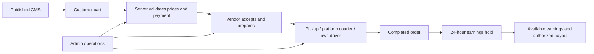

# Goodies — operating guide

Latest verification: [28 November cross-role audit](../../../docs/goodies/re-audit-20261128/README.md), including screen/control registers and explicit acceptance limits.

This is the guide to the existing Goodies customer app, vendor dashboard, courier workspace and admin panel. It describes the implemented rules and the live configuration observed on **22 November 2026**. Amounts and switches below are a dated snapshot, not permanent defaults.

**Readiness:** Goodies has real backend workflows and enabled Wallet operations, but is **not certified for production release**. Installed cross-role/device acceptance, payment-provider reconciliation and recovery checks remain open. Owner-deferred work is listed separately below. See the [confirmed-gap repairs](../../../docs/goodies/confirmed-gap-repairs-20261122.md) and [audit and evidence](../../../docs/goodies/operating-guide-audit-20261122/README.md); older reports are historical snapshots.

## 1. One system, four roles

| Role | Interface | Responsibility |
| --- | --- | --- |
| Customer | `src/features/Goodies`, mounted through `src/screens/Goodies/goodiesHomeScreen.tsx` | Discover stores, customize products, order, pay, track, review and contact support. |
| Vendor | `src/screens/businessSpace/BusinessSpaceGoodies*` and shared Business Space | Configure the store, manage listings/builders, accept and fulfill orders, view settlements and request payouts. |
| Courier | [GoodiesCourierScreen.tsx](GoodiesCourierScreen.tsx) | Manage availability, respond to offers, collect orders, report real GPS and complete deliveries. |
| Admin | `momojdy/tiss-admin` | Manage merchants, moderation, orders, couriers, disputes, finance, assets and CMS content under staff permissions. |

All four use the existing Wantiss Supabase project, **`ycbirmgppwavorwudlrv`**, in `us-east-1`. They share Supabase Auth and the main Wantiss account. Goodies uses the existing account addresses; its selected address/contact preferences do not create another customer identity or silently replace the main account's default address.



Supabase owns catalogue eligibility, inventory, orders, payments, contributions, permissions and financial records. Local storage holds account-owned caches, carts, builder drafts and recovery/idempotency journals. A cached price, order or Wallet balance cannot authorize a charge or make an unavailable item purchasable.

## 2. Customer screens and normal shopping

There are **34 registered Goodies customer routes**, including the `wantiss` Home alias. This is not the total number of screens across every role. The main Wantiss Wallet contribution screen, vendor screens, courier workspace and admin modules are additional surfaces.

| Routes | What they do |
| --- | --- |
| `home`, `wantiss` | Published promotions, service tiles, categories, current stores and delivery-address selection. |
| `cats`, `catlist`, `explore` | Category/store discovery, availability and the existing filtering destinations. |
| `search` | Search real catalogue data and show genuine empty/error states. |
| `store`, `reviews` | Store information, eligible products, real moderated reviews, favorites, messaging, sharing and group-order entry. |
| `product`, `byo` | Product options, quantities, notes and supported builders; backend validation determines the payable price. |
| `cart` | Edit/remove items, apply supported promos, select fulfillment and review one-store or supported multi-store totals. |
| `checkout` | Delivery/contact details → time → payment method → final review and submission. |
| `help-pay` | Create/recover a Wallet funding request, invite helpers, monitor funding or cancel it. |
| `grouporder` | Coordinate a shared single-store cart and host checkout. |
| `addcard`, `cardauth`, `payments` | Shared Wallet/card setup, saved payment methods and bank authentication/recovery. |
| `confirm`, `track` | The actual order receipt, current fulfillment state, maps, eligible receipt confirmation and delivery reports. |
| `orders` | Paginated order history, details, cancellation and supported reorder actions. |
| `promos`, `flashdeals`, `favs` | Published offers and saved items/stores; removed or unavailable listings stay unavailable. |
| `notifs`, `ndetail` | Real notification history and its intended order/product/message destination. |
| `settings`, `profile`, `addresses` | Existing account/profile/address integration and Goodies preferences. |
| `help`, `contact`, `storechat`, `supdone` | Help, real support submissions, authorized store conversation and confirmed submission receipts. |
| `policies`, `policy` | Published policy content; unfinished text is not evidence of an approved policy. |

Normal Goodies entry restores owned local state and refreshes backend data without the branded entry loader. **Only a shared shop opened from messages uses “Opening store.”** The shell consumes that destination once so a later normal visit does not reopen the previous shop. Real section loading, empty, error and retry states remain necessary.

Scheduled checkout selects the earliest valid five-minute slot across the existing seven-day picker. It checks every participating store's hours, configured minimum local clock time and time zone, plus the existing fifteen-minute client safety margin. Unavailable days are disabled; earlier/closed times are clamped to valid slots. Checkout applies the displayed choice directly. The separate Cart/modal Apply action remains. Android opens its clock only on a tap; iPhone keeps the wheel. The server validates the submitted schedule again.

## 3. Store, product and builder rules

The vendor uses the existing business onboarding, activation and application/document review. Store setup includes business information, address/map coordinates, hours, photos, live status, delivery/pickup choices, delivery pricing and scheduled-order settings. Restrictions, publication and ownership are enforced on the server.

Product saves use business-scoped RPCs. New or materially edited products go through moderation. Admin rejection requires a reason. Availability/stock changes cannot override rejection or approve a product; rejected/pending products cannot become purchasable through the availability switch. Historical orders retain their purchased item snapshots if a product or store is removed.

Builder configuration and ingredient availability/prices come from authorized vendor/admin records. The customer cannot make a builder cheaper by changing its submitted price, ingredient identity or selection limits. Admin manages the shared ingredient library and requests; merchant-specific configuration stays merchant-owned.

**Alcohol is prohibited by the current backend listing/order rules.** Legacy age-check copy is not a promise that alcohol sales are enabled.

## 4. Pricing, platform fees and commissions

Internal order and Wallet accounting is in **USD**. Currency conversion uses validated server exchange-rate records, with an immutable snapshot where required. Customer-entered amounts, QR text and editable CMS captions are not financial authority.

For an ordinary order:

```text
Payable total = validated product subtotal
              - validated product discount
              + payable delivery fee
              + customer service fee
              + authorized courier tip
```

The server checks product/option/builder prices, stock, store minimums, promo eligibility, delivery quote, allowed tips and the exact total. A price or quote change requires review; a lost response must recover the original checkout instead of charging again. There is no separate automatic tax term in this checkout formula; a jurisdictional tax engine must not be assumed.

Discount authorization comes from `goodies_promotions`, not an edited coupon caption. Admin → Goodies → Promotions provides finance-controlled creation, editing and activation of percentage/free-delivery codes, store scope, minimum subtotal, validity timestamps and total redemption limits. Review reasons and audit records are required; already redeemed financial terms cannot be rewritten. Public content endpoints overlay current eligible financial offers onto CMS wording. Marketing drafts cannot authorize discounts. Global campaign features such as fixed-amount discounts, funding budgets, weekday rules and per-customer caps are outside this supported Goodies coupon contract.

| Component | Current implemented rule |
| --- | --- |
| Product commission | **10% of the discounted product subtotal**, rounded to cents. |
| Vendor product earnings | Discounted product subtotal minus that 10% commission. |
| Delivery commission | **7% of the payable delivery fee**, rounded to cents. |
| Delivery share | Remaining 93%; an own-driver merchant receives this delivery share through its vendor entitlement. |
| Tip | Separate from the product/delivery commission calculation; assigned delivery entitlement depends on who fulfills the order. |
| Customer service fee | Admin-configured flat amount; **currently $0** in published content version 6. |
| First-delivery promotion | **Currently enabled.** The implemented test is “no earlier delivery-order record,” not “no earlier successfully completed delivery.” |
| Tip choices | **Currently $0, $1, $2 or $3**. The backend validates the selected amount. |

The 10% and 7% rates are server commission rules, not editable text labels. They are deducted from the relevant earnings allocation; the customer is not charged an extra 10% on top of the checkout total. The service fee is a separate customer charge. Platform revenue is before payment-processing or other operating costs; it is not automatically net profit or a company-Wallet withdrawal.

**Example — an existing customer with a valid 10% product promo:** $20 products − $2 discount + $3 delivery + $0 service fee + $1 tip = **$22 paid**. Product commission is **$1.80**; vendor product entitlement is **$16.20**. Delivery commission is **$0.21**; delivery share is **$2.79**, plus the $1 tip. Platform allocation is **$2.01** before costs. This is an illustration, not a production order or a promise that every store charges $3 delivery.

### Delivery and multiple stores

A store can use a fixed delivery fee or distance pricing: base fee + road kilometers × per-kilometer fee, bounded by configured minimum/maximum fees and delivery range. Geoapify supplies the road distance/geometry. A failed route is not silently replaced with a fabricated payable quote.

For multiple stores, the current quote sums each store's base delivery fee. If enabled, it adds an additional-store charge for each stop after the first and a configured charge for the additional stores' road distances to the destination. Those distances are not a promised optimized store-to-store courier itinerary. The surcharge is allocated in integer cents across the store orders so their shares equal the displayed total. First-delivery/free-delivery rules and child-order validation are enforced by the server. The published fee bundle currently omits surcharge settings, so those optional surcharges default off; store delivery fees still apply.

Multi-store checkout is delivery-only and uses the server maximum-stop policy (the existing default is three). It creates linked store-specific orders with separate fulfillment/refund states. A failed or declined store must not duplicate or arbitrarily cancel another store's order.

## 5. Supported payment flows

| Flow | Supported payment scope in the current customer implementation |
| --- | --- |
| Ordinary single-store checkout | Wantiss Wallet, saved credit/debit card, or eligible cash on delivery. |
| Multi-store checkout | Wallet or eligible cash; the customer UI excludes card and pickup for this flow. |
| Group Order checkout | The host's Wantiss Wallet pays the shared cart. |
| Help Pay / Shared Bill | Wallet contributions against a single-store checkout. |

Published switches currently enable Wallet, Card and Cash and disable MonCash checkout. **MonCash checkout and MonCash vendor payout are different capabilities.** Neither should be inferred from the other.

Wallet payment debits the authenticated account through an idempotent server transaction. Card setup/checkout uses the trusted server's Stripe customer binding, saved methods and supported bank-authentication flow. Stripe webhook signature verification, event deduplication and payment-state processing determine confirmed payment; a client success screen is not authority. Internal worker endpoints use their own protected authentication even where gateway JWT verification is disabled.

Cash is offered only when the server's store/global/settlement/rate/exposure rules allow it. With settlement activated, merchant-managed COD can operate before a Wantiss courier is available. Checkout describes store/order eligibility without claiming an available platform courier is always required.

## 6. Order lifecycle and cross-role updates

The normal backend progression is `scheduled`/`placed` → `accepted` → `preparing` → `ready` → `picked_up` → `completed`. Cancellation, decline and expiry are separate terminal outcomes. Payment states and delivery-assignment states are separate from this order status.

| Event | Required result across the system |
| --- | --- |
| Checkout succeeds | One authorized order/stock reservation and a confirmed payment outcome; the relevant vendor/admin can see it. |
| Vendor accepts | Server checks merchant/staff authority, valid payment state and applicable cash exposure; preparation becomes available. |
| Vendor declines / permitted customer or admin cancellation / acceptance expiry | Valid terminal transition, inventory recovery and the appropriate Wallet or original-card refund workflow. |
| Ready / courier offer | Eligible approved courier receives an assignment; offer acceptance, expiry and reassignment use backend state. |
| Courier pickup/completion | Only the assigned authorized courier can perform its transition and report location; completion updates the order and settlement facts. |
| Merchant uses own driver | Merchant handoff/delivery evidence is recorded; customer can confirm receipt or report a delivery problem. |
| Review submitted | Review is persisted against an eligible real order and enters the existing moderation/display workflow. |
| Refund or dispute changes | Payment and settlement eligibility update; pending/disputed money is not spendable vendor earnings. |

New-order acceptance has a server expiry worker. Scheduled orders follow their backend due/acceptance rules rather than a client-side countdown inventing fulfillment. Customers cannot cancel an arbitrary status merely because a button is hidden or visible.

**Receipt distinction:** platform-courier delivery is completed by the authorized courier transition. The explicit customer receipt-confirmation RPC is for the **own-driver** flow. An own-driver delivery with valid proof and no report can auto-complete after its 24-hour receipt deadline. The earnings hold begins from completion; without earlier customer confirmation, this can make availability later than 24 hours after the merchant first marks delivery.

### Cancellation, refunds and recovery

Automatic paid-Wallet cancellation returns the paid order total; a fulfilled Help Pay order refunds its actual contributors instead of giving every payer's money to the creator. Expired/cancelled/failed Help Pay funding also returns each recorded contribution exactly once. A recovery failure remains refund-pending for authorized retry.

**Card refunds go back to the original card**, as instructed by the owner. The worker accounts for existing successful/pending refunds, uses idempotent provider requests and processes only the remaining amount. Partial provider refunds/disputes affect payment and vendor-entitlement reconciliation. A cancelled order can remain refund-pending until the provider confirms completion. Cash return/reconciliation must be handled as an actual cash operation; a Wallet or card refund must not be invented for cash that was never charged that way.

The legacy `rfSvc`/`rfTip` content flags are not evidence of cancellation deductions: the current automatic Wallet cancellation helper refunds the whole paid total and the card worker reconciles the remaining order total. Do not promise a fee-retention policy from those flags alone.

Checkout/contribution/payout/commission journals retain the original idempotency key across double taps, timeouts and restarts. Recovery checks backend state before allowing a new financial intent. Changing accounts invalidates the previous account's pending UI responses and owned cache.

## 7. Group Orders versus Help Pay

These are different products.

**Group Orders:** a host creates a single-store group; other signed-in participants join through the existing invitation/code flow and contribute their own cart items. Server membership and item ownership govern edits. The host reviews the shared cart and pays the **entire amount from the host's Wallet**. Joining a group does not authorize Wantiss to debit every member. The server locks checkout, validates the current quote/items, creates the host's order once and closes the group. Group expiry is server-provided and is separate from Help Pay's timer.

**Help Pay / Shared Bill:** friends fund one customer's order from their Wallets. The resulting order belongs to the **original customer**, not the last contributor.

1. The customer chooses **Share Bill** or **Pay in full** for a validated single-store checkout.
2. Share Bill immediately debits/reserves **60%** from the creator's Wallet, rounded up to the nearest cent; helpers fund the remaining **40%**. Pay in full reserves **$0** from the creator and requires a helper to pay the entire remaining bill.
3. The backend creates an active request valid for **30 minutes**. Messages, a native share link and QR identify the request; a QR-encoded amount cannot override the server total.
4. In share mode, helpers can contribute a permitted amount or a percentage of the **remaining** balance. For a $100 bill, the creator supplies $60; 25% of the remaining $40 means a $10 contribution. In full mode, the helper must pay the whole remaining amount.
5. The backend serializes contributions and locks Wallets. The last valid contribution revalidates the stored checkout, creates one paid order and reserves stock once. Stock is not guaranteed merely because a funding request exists; changed/unavailable inventory or prices can cause finalization to fail and contributors to be refunded.
6. Cancellation, expiry or failed finalization refunds each payer's recorded amount once. Once an order is fulfilled, use its order cancellation/refund workflow rather than trying to cancel the already-fulfilled funding request.

Funding requires a signed-in helper and sufficient Wallet balance. An active request is shareable by its identifier; it is not an invitation-only private payment room. The backend withholds other contributors' details from helper views and keeps the creator as order owner. Friendship checks protect the in-app invitation/message action. The creator cannot use the helper endpoint to contribute again as another person.

The **backend Wallet funding switch is enabled**. The development and future production EAS profiles opt into `EXPO_PUBLIC_GOODIES_SHARED_PAYMENTS_RELEASED=true`; an environment/build without that opt-in still hides new funding. Existing installed binaries are not updated by changing the database. Status/cancellation/refund recovery remain available independently of new-funding activation. No external payment-provider credentials are required for this Wallet-only flow.

## 8. Cash sales, commission collection and the 5,000-gourde cap

The **5,000 HTG limit measures outstanding cash-sales exposure**, not a 5,000-gourde fee allowance, a Wallet balance, a loan, or lifetime sales. The server converts the order's total using a fresh approved USD→HTG quote and records its rate snapshot. Concurrent acceptance rechecks the cap under a business lock.

| Cash fulfillment | Who initially holds the cash | Settlement treatment |
| --- | --- | --- |
| Merchant/own-driver collection | Merchant | Cash already collected is not paid to the vendor a second time from Wantiss. After completion and the hold, the merchant owes product commission + customer service fee + delivery commission. |
| Wantiss courier collection | Courier, pending remittance | Vendor entitlement waits for a finance-authorized admin to confirm the exact cash remittance/reference, as well as the completion/hold rules. This is not the same as trusting the courier's delivery status as proof of remittance. |

The merchant pays matured cash commissions through **Pay commission** from its Wantiss Wallet. This is a real idempotent Wallet debit, not a checkbox recording a promise to pay. Settled or reversed exposure is released according to its fulfillment/refund state. Completed platform-courier cash deliveries release the vendor exposure calculation while their vendor earnings still require the separate remittance confirmation.

At the cap or with overdue matured commission, **new COD eligibility pauses**. Existing orders/recovery are retained; this is not automatically an account ban or a prohibition on otherwise eligible digital-payment orders. Paying the due commission can restore eligibility. A shop may start accepting eligible cash orders without prepaying the entire sales amount, but later needs sufficient Wallet funds to settle what it owes.

**Weekly rule as implemented:** unpaid matured cash commission becomes overdue **seven days after its hold ends**. The hourly reminder job checks this rolling deadline. This is not a calendar-wide Monday/Sunday payout batch and does not automatically send every merchant a transfer once a week. If a fixed weekly batch is intended later, it needs a separate explicit implementation.

The USD→HTG refresh worker is enabled and runs every four hours against the existing rate table. It preserves the configured Wantiss adjustment, checks source freshness/format/change limits, and never extends an old observation simply because it was fetched again. At this audit, a valid Wantiss quote of **132.6161616162 HTG/USD** expired on **26 November 2026 at 00:00 UTC**. This is a dated reference, not a value to hardcode. Stale/missing rates block new affected cash operations.

## 9. Earnings hold and payouts

An eligible completed order's earnings remain **pending for 24 hours**. Open/lost disputes, unresolved refunds, cash-remittance requirements and recovery debt can block available earnings. Availability is not gross sales and must not be shown as a spendable zero when the financial request failed.

Settlement was activated at **22 November 2026, 02:07:21 UTC**. Older orders are not silently turned into fresh entitlements; they require reconciliation under the activation procedure.

| Destination | Agreed/implemented timing after earnings are available and a request is accepted | Live availability |
| --- | --- | --- |
| Wantiss Wallet | Instant internal Wallet credit, with ledger and idempotency protection. | **Enabled** |
| GCash, MonCash, NatCash | Two calendar days in the prepared payout model. | **Disabled; deferred by owner** |
| Bank transfer | 7–14 business days, requiring a verified destination and reviewed country banking calendar. | **Disabled; deferred by owner** |

The 24-hour hold and transfer timing are separate clocks. “Instant Wallet payout” does not mean bypassing the hold or instantly cashing out to a bank/mobile-money provider. Wallet payout requires an authorized business owner, verified business, a valid Wallet and sufficient available earnings. Staff cannot obtain payout authority by displaying the button. Payout requests do not create duplicate entitlements on retries.

External destination/processing controls and expected-receive/FX checks exist in the model, but disabled channels are not finished provider integrations or a promise of a successful transfer. Courier delivery allocation also must not be mistaken for proof of an automatic courier-Wallet/provider payout.

## 10. Real delivery maps and evidence

The map uses actual store coordinates, the selected customer's destination, recorded route geometry and the assigned courier's authorized device GPS. Geoapify provides road routing; `react-native-maps` renders the native map. The map does not animate an invented courier.

Incoming native fixes must be recent. A displayed courier fix older than **two minutes** is stale; a **30-second** freshness timer removes stale markers even without a Realtime update. Missing road geometry shows known locations and an explicit unavailable-route state; it does not draw a straight line and call it a road route. Pickup maps use the store's available coordinates. Own-driver delivery must not claim live GPS when none is reported.

Private delivery-proof uploads are enabled. The `goodies-delivery-proofs` bucket is **private**, allows JPEG/PNG/WebP up to **10 MiB**, and uses authorized access/signed viewing rather than public proof URLs. Legacy public proof uploads remain rejected even if the new upload switch is paused. Physical camera/upload/viewing acceptance remains open.

Supabase remains the backend. Android native Maps still needs the Google Maps SDK key and package/certificate restrictions. Android push uses Google's FCM transport; iPhone push uses APNs. Using those transports does not replace Supabase with a Firebase application backend.

## 11. Admin operations and notifications

The current Goodies module registry contains **14 modules**: Overview, Merchants, Product review, Customer reviews, Orders, Delivery reports, Couriers, Support, Settlement, Fees, Delivery surcharge, Analytics, Goodies assets and Content editor. Ingredient library/request and builder operations connect through their existing admin/editor locations.

Admins approve/reject products and merchants, manage restrictions, inspect/cancel eligible orders, resolve delivery reports, manage couriers, inspect/retry authorized refund work and review financial operations. The server must check active staff/permission level and record sensitive decisions. Fee controls use protected financial RPCs; a text edit must not rewrite commissions or payment state.

Order/payment/moderation/message/support events create real backend notifications for their intended participants. In-app history, preferences and destinations are separate from device push. **Push registration/delivery rollout is currently disabled** even though its worker/job and Expo project binding exist. FCM/APNs setup, activation and physical foreground/background/reopened-app delivery remain to be accepted. A stored email preference is not proof that an email delivery provider has sent mail.

## 12. Content editor and five languages

The source-derived editor catalogue covers **34 routes, 73 page/shared groups and 1,921 current text fields**. Group/card/shared Wallet copy is included where referenced. Platform headings, buttons, empty/error/success text and platform artwork belong in the CMS. Vendor business/product data, customer addresses/identity, and protected financial configuration keep their existing owners and controls.

The exact locales are **`en`, `fr`, `ht`, `es`, `zh-Hans`**. Other languages can be nested inside one English `goodies.content` payload; separate published rows are not required. At this audit, published bundle version **6** contains **2,091 label records**, including **all 1,921 current source label IDs** plus historical/additional keys. Only 647 English labels are marked reviewed; the four other locales each contain 129 nonempty labels and none marked reviewed. Key presence does not establish translated screen acceptance.

Publishing and translation review are now separate. **Unfinished FAQ/translation review does not block the publish action.** The production resolver still selects reviewed locale text and falls back to eligible English or the application-owned fallback. Home also preserves its published legacy English source. Consequently, publishing an unreviewed translation does not make that translation appear automatically. Editing, marking a translation reviewed, saving, draft preview, publishing and customer reload are distinct steps. Machine copy must not be represented as human-reviewed Creole.

CMS publication carries forward the current live fee configuration. Use the protected **Fees** controls for authorized financial changes; a content draft is not a way to replace live checkout rules.

The owner will review Haitian Creole. Unfinished Creole falls back to English; the prepared four-language content is not evidence that all four locales have been delivered in the installed app. The five existing FAQ placeholder answers remain deferred and are filtered from customer answers rather than presented as genuine help.

The admin phone preview mirrors actual customer components with isolated fixture/backend/storage/device ports. Draft navigation, content selection, translations and zoom belong there; fixtures cannot perform live payments or approvals. Regenerate mirrors/catalogues with `npm run sync:goodies-cms`. Preview success alone does not prove hosted publish → installed-customer reload.

## 13. What the owner explicitly deferred

| Deferred work | Current treatment |
| --- | --- |
| Final FAQ/support answers and approved terms/privacy/refund-policy content | Retained for the final content pass. Publishing no longer treats FAQ placeholders as a technical blocker; that does not approve unfinished policies. |
| Final localization acceptance, especially Haitian Creole | Owner reviews Creole; source fallback remains. Prepared/published/reviewed/device-verified are recorded separately. |
| Bank, GCash, MonCash and NatCash payouts | Channels stay off until provider integrations, destination checks and reconciliation are ready. Wantiss Wallet payout stays enabled. |
| Leaked-password protection | Still disabled; owner plans to enable it when upgrading from the free plan. This remains a known disabled security safeguard. |
| Production backup export and full restoration | Owner said no export for now. Historical synthetic local recovery does not certify a full production restore. |
| Releasing the complete Wantiss app | No store release or OTA until the other super-app features are finished. Backend-only work may be authorized separately. |

**Not deferred/disabled anymore:** Shared Bill Wallet funding, vendor settlements and private delivery-proof uploads are enabled in the live backend. Native installation, provider acceptance and cross-role verification are unfinished acceptance work, not automatically owner-approved exclusions.

## 14. Audit result and work still required

The fresh audit traced 112 scoped files, 1,349 interaction bindings and 537 navigation call sites. Recognized literal destinations resolve; **17 dynamic registry targets still require runtime acceptance**. Static bindings are not an exhaustive count of every button instantiated on a phone.

Live metadata confirms 26 Goodies tables plus two Help Pay tables have RLS enabled; protected order money/ownership columns are not directly writable by authenticated clients, and the inspected base placement/Wallet/request-refund helpers are not client-callable. Eleven deployed Edge entry files match source. These facts do not replace wrong-role execution tests or certify every `SECURITY DEFINER` body.

| Classification | Current conclusion |
| --- | --- |
| **PASS — scoped evidence** | Source route/CMS coverage; inspected literal Goodies RPC signatures; enabled Wallet/settlement/private-proof switches; private bucket metadata; selected financial/recovery/GPS tests; client secret scan; deployed Edge entry comparison. See the evidence for exact limits. |
| **PASS — scoped dispatch tests** | Explicit Goodies workspace context uses Goodies APIs even for mixed-feature businesses. Unrelated feature contexts retain their existing APIs and are not certified by this Goodies repair. |
| **FAIL — deferred safeguard** | Leaked-password protection is disabled as acknowledged by the owner. |
| **PASS — source consistency** | COD wording reflects store/order eligibility; the editor catalogue and phone-preview mirror are synchronized. Installed acceptance remains open. |
| **PASS — isolated/backend checks** | Dedicated finance-authorized promotion operations, public offer terms, audit, stale/concurrent edits and eligibility rules pass focused checks. Signed-in installed admin/customer acceptance remains open. |
| **NOT VERIFIED** | Every installed customer/vendor/courier/admin interaction and restricted-staff/cross-account authorization path; complete cross-role order outcomes; physical GPS/background/offline/push/proof behavior; configured signed installers; installed card/3DS/provider reconciliation; installed CMS reload; full production restore. |

Provider test history includes successful API scenarios, but the existing shared Stripe test account forwards events to hosted Wantiss. Further synthetic financial testing must use an approved isolated **Stripe** sandbox with no forwarding to live Wantiss. Do not create hosted isolated Supabase tests/projects or real-money tests to fill this gap.

The owner has Android and iPhone devices, but no paid Apple Developer membership was confirmed. A Google Cloud Wantiss project is visible; this alone does not verify Android Maps/FCM credentials, restrictions or a correctly configured installer. Expo Go helps inspect screens but does not certify all background/native/signing/push behavior. Native compilation/debug-signature checks and JavaScript exports are not production signing or physical acceptance.

The observed customer CI workflows pass. The last observed admin CI run failed two obsolete tests that still required editorial review to block publishing. This audit updates those expectations and verifies the two focused cases, including production fallback and unchanged review statuses. The full admin suite/CI was not rerun for this minor test/documentation update; see the [CI observation](../../../docs/goodies/operating-guide-audit-20261122/ci-observation.json).

## 15. Maintenance and evidence

Start with the [22 November audit](../../../docs/goodies/operating-guide-audit-20261122/README.md), [activation procedure](../../../docs/goodies/activation-20261122/README.md), [FX producer](../../../docs/goodies/fx-refresh-20261122/README.md), and [checkout/entry changes](../../../docs/goodies/checkout-time-entry-20261122/README.md).

For focused checks, use the relevant existing `tests/goodies-*.test.cjs` files, `npm run check:goodies-cms`, the client-secret check, required lint and TypeScript. Run broader unit/cross-role/isolated PostgreSQL/Deno/native checks when a functional or financial change warrants them. Do not rerun the full suite merely for this documentation edit. Historical test counts apply to their recorded revisions.

Reconcile migrations by actual schema/function effects and reviewed dependencies, not merely by a missing version in the production ledger. Current history contains different prepared/deployed timestamps. Preserve the existing project, financial snapshots, recovery journals and audit trail; do not reset production or introduce a parallel backend. This audit updates documentation/evidence and two obsolete test expectations: no application behavior/UI change, CMS publication, backend deployment, hosted synthetic test, real charge or Wantiss app release.
